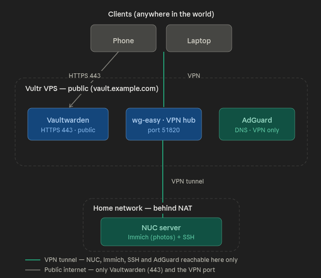

# Self-Hosted Privacy Stack

A private, self-hosted infrastructure that replaces several commercial cloud services with services I host and control myself: a password manager, a photo cloud, a personal VPN, and a network-wide ad blocker.

The stack runs across two nodes — a rented VPS for the public-facing services and a home server for private data — tied together by a VPN that makes every device act as if it were on one local network.



## Services

| Service | Role | Runs on | Exposed to the internet |
|---|---|---|---|
| Vaultwarden + Caddy | Password manager (Bitwarden-compatible) | VPS | Yes (HTTPS only) |
| wg-easy / WireGuard | VPN hub | VPS | VPN port only (51820/udp) |
| AdGuard Home | Network-wide DNS ad blocker | VPS | No — VPN-only |
| Immich | Photo cloud (Google Photos alternative) | Home NUC | No — VPN-only |

Only the password manager and the VPN port are reachable from the internet. Everything else is accessible only through the VPN. This "minimal attack surface" principle is the backbone of the whole design.

## How it works in one paragraph

The VPN server runs on the VPS. The home NUC and all personal devices connect to it as clients, so they all share one private subnet. From anywhere in the world, once connected to the VPN, I can reach the home server over SSH or open Immich using its internal address — as if I were home on the same Wi-Fi — without exposing the home server to the internet at all.

## Repository structure

```
.
├── README.md                     # this file
├── docs/
│   ├── architecture.md           # design decisions and why they were made
│   ├── deployment.md             # step-by-step setup from a clean server
│   ├── security.md               # threat model, hardening, real incidents
│   └── images/                   # screenshots and diagrams
└── examples/                     # ready-to-use compose files (sanitized)
    ├── vaultwarden/
    │   ├── docker-compose.yml
    │   ├── Caddyfile
    │   └── .env.example
    ├── wg-easy/
    │   └── docker-compose.yml
    └── adguard/
        └── docker-compose.yml
```

## Documentation

- [Architecture](docs/architecture.md) — the two-node design, the VPN hub, and the reasoning behind each technology choice.
- [Deployment guide](docs/deployment.md) — a chronological walkthrough from renting the VPS to running every service.
- [Security](docs/security.md) — the real threat landscape, the move from fail2ban to key-only SSH, and lessons learned from actual mistakes.

## A note on the example values

All domains, IP addresses, and tokens in this repository are placeholders:

- `example.com` / `vault.example.com` — replace with your own domain
- `203.0.113.10` — replace with your server's public IP
- `10.42.42.0/24` — the internal Docker network (a private range, safe to keep)
- every secret (`ADMIN_TOKEN`, passwords) must be generated yourself — see `.env.example`

Never commit real secrets. The included `.gitignore` already excludes `.env` files and data volumes.

## License

MIT — see [LICENSE](LICENSE).
