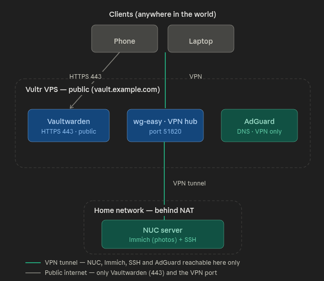

# Architecture

## Two nodes instead of one

The most important decision in this project is splitting the workload across two nodes.

**VPS (public part).** Hosts the services that must be reachable from outside or always online: the password manager, the VPN server, and the DNS filter. The VPS has a static public IP and does not depend on my home internet connection.

**Home server — Intel NUC (private part).** Hosts Immich with the photo archive. The reason is simple: storage is expensive. A photo archive is tens to hundreds of gigabytes. Renting a VPS with that much disk is costly, while a home NUC with a 512 GB SSD provides that space as a one-time hardware purchase. The NUC has no public address and sits behind the home router (NAT) — it is not visible from the internet at all.

## How the VPN ties everything into one network

The key idea of the architecture: the VPN is not just "to hide traffic" — it works as a hub that joins scattered devices into one virtual network.

The VPN server runs on the VPS. The home NUC keeps a permanent connection to it as a client. My personal devices are clients too. As a result, they all end up on the same private subnet. When I am connected to the VPN, I can reach the home NUC on its internal address — open Immich or log in over SSH — as if I were physically home on the same Wi-Fi, even though I may be in another country.

This elegantly solves the problem of reaching a server behind NAT: there is no need to forward ports on the home router or to have a static home IP. The home stays invisible to the internet, and access is limited to whoever is on the VPN.

## Technology choices and why

**WireGuard (via wg-easy).** A modern VPN protocol: fast, simple, runs in the Linux kernel. wg-easy adds a convenient web panel with QR codes, so non-technical family members can be connected with a single scan.

**Caddy (reverse proxy).** Automatically obtains and renews Let's Encrypt TLS certificates. This removes an entire class of manual certificate work.

**AdGuard Home (DNS).** Filters ads and trackers at the DNS level — so it applies to every device on the VPN at once, without installing a blocker in each browser.

**Docker.** Every service runs in a container. This isolates them from each other, simplifies updates and migration, and makes the configuration reproducible.

**Vultr (VPS provider).** Chosen for the low price of the cheapest plan with a public IPv4 address and for the provider's reliability. A deciding factor was prior successful experience renting a VPS from Vultr and configuring its firewall.
