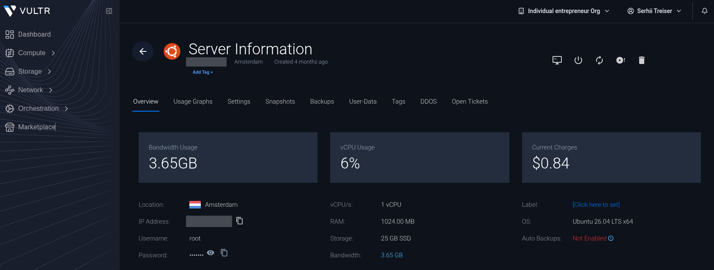
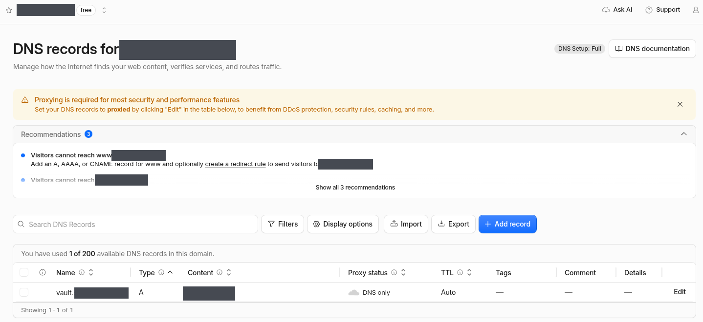
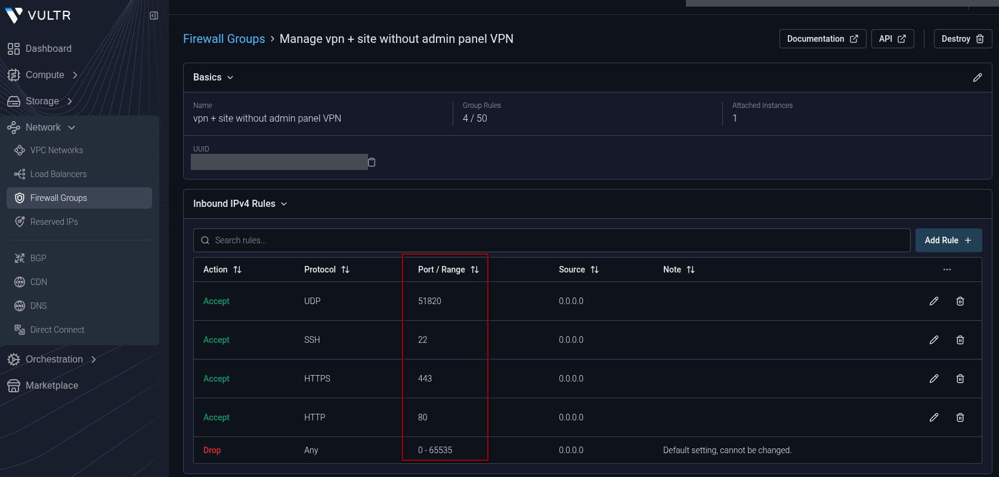
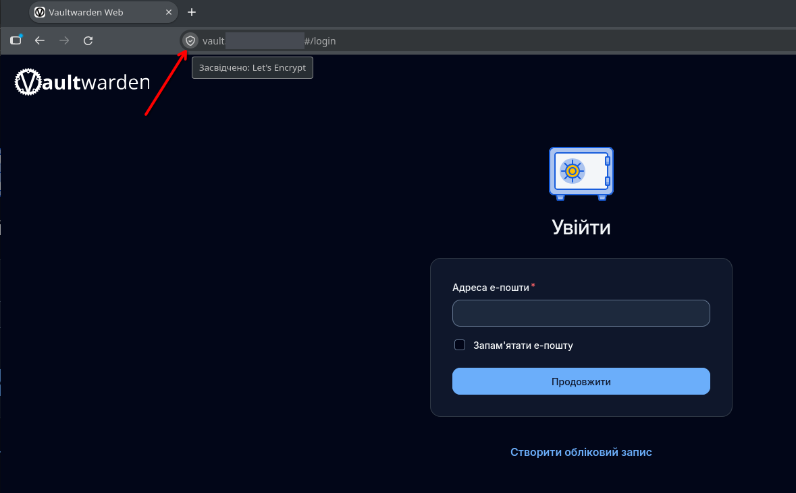
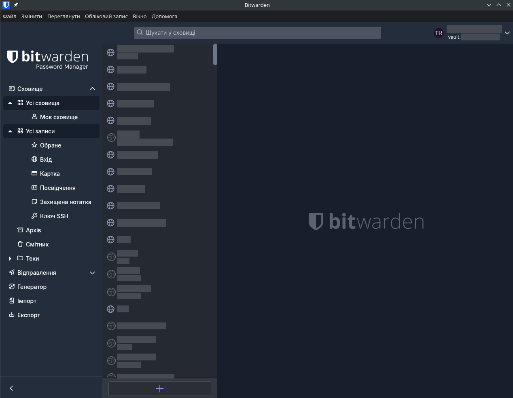
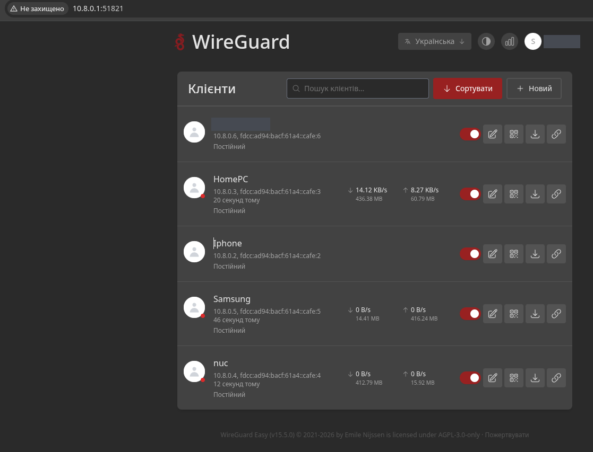
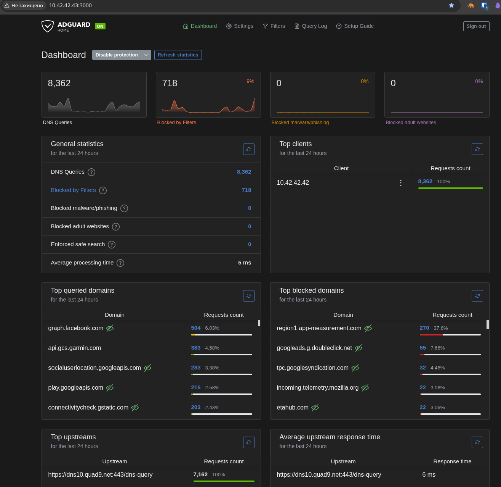
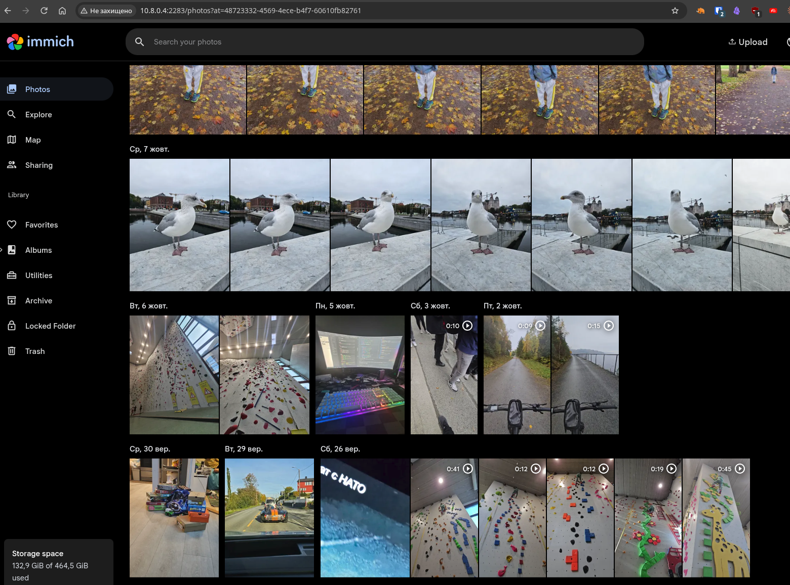
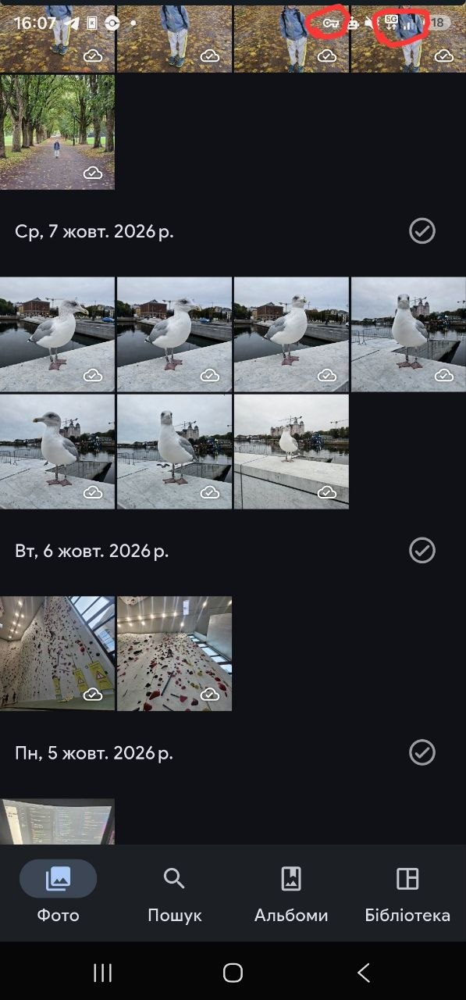

# Deployment Guide

A chronological walkthrough from a clean server to a fully working system. The order of steps is exactly how it should be done on a fresh server.

Placeholders used below:

- `203.0.113.10` — the VPS public IP
- `vault.example.com` — the domain for the password manager
- `10.42.42.0/24` — the internal Docker network for VPN and DNS

Ready-to-use compose files for each service live in [`examples/`](../examples/).

## Overview

1. Rent a VPS (Vultr)
2. Domain and DNS record (Cloudflare)
3. Base server setup
4. Firewall (two levels: Vultr + system)
5. SSH key-only, disable password login
6. Docker
7. Password manager (Vaultwarden + Caddy + HTTPS)
8. VPN (wg-easy / WireGuard)
9. Ad blocker (AdGuard Home) + VPN wiring
10. Home server (NUC) + Immich
11. Updates and backups

---

## 1. Rent a VPS

Create a server (instance) in the Vultr panel. Choose a plan with a public IPv4 address and enough memory for lightweight services (the password manager, VPN, and DNS use little). Operating system: Ubuntu (LTS).

After creation, Vultr shows the server's public IP — referred to below as `203.0.113.10`.



---

## 2. Domain and DNS (Cloudflare)

The password manager needs a domain, because the Bitwarden apps require HTTPS and the certificate is issued to a domain name.

In Cloudflare, create a DNS record for `example.com`:

- Type: **A**
- Name: `vault`
- Address: `203.0.113.10`
- Proxy status: **grey cloud (DNS only)**, NOT orange — otherwise TLS certificate issuance will fail.

This creates `vault.example.com` pointing to the VPS. Verify from the server (should return the server IP):

```shell
dig +short vault.example.com
```



---

## 3. Base server setup

Connect to the server and do the initial setup as `root`.

Swap — a memory reserve for spikes (important on a small server):

```shell
fallocate -l 2G /swapfile && chmod 600 /swapfile && mkswap /swapfile && swapon /swapfile
echo '/swapfile none swap sw 0 0' >> /etc/fstab
echo 'vm.swappiness=10' > /etc/sysctl.d/99-swappiness.conf && sysctl -p /etc/sysctl.d/99-swappiness.conf
```

Automatic security updates — so critical patches install themselves:

```shell
apt update && apt install -y unattended-upgrades
echo 'unattended-upgrades unattended-upgrades/enable_auto_updates boolean true' | debconf-set-selections
DEBIAN_FRONTEND=noninteractive dpkg-reconfigure -f noninteractive unattended-upgrades
```

---

## 4. Firewall (two levels)

An important lesson from this project: on Vultr the firewall operates on two levels, and both must be configured.

### Level 1: system firewall (ufw) on the server itself

```shell
ufw default deny incoming
ufw default allow outgoing
ufw allow OpenSSH
ufw allow 80/tcp
ufw allow 443/tcp
ufw allow 51820/udp
ufw --force enable
```

This blocks all incoming traffic except the needed ports: SSH (22), HTTP/HTTPS (80/443) for the password manager, and 51820 for the VPN.

### Level 2: Vultr cloud firewall

In the Vultr panel, create a Firewall Group and attach it to the server, allowing the same ports. This level sits in front of the server — traffic is filtered before it even reaches ufw.

Why both levels: when Docker publishes ports, it writes its own rules that bypass ufw. So a service port can become reachable from outside even if ufw is set to block it. The Vultr cloud firewall is an independent barrier that guards against this.



---

## 5. SSH key-only

Goal: make password brute-forcing by bots impossible.

Create and verify the key first, and only then disable password login — otherwise you can lock yourself out.

1. Generate an SSH key on your local machine (if you do not have one):

```shell
ssh-keygen -t ed25519
```

2. Copy the public key to the server:

```shell
ssh-copy-id root@203.0.113.10
```

3. Verify that key login works (it should let you in without asking for a password):

```shell
ssh root@203.0.113.10
```

4. Only after a successful test, disable password login. In `/etc/ssh/sshd_config` set `PasswordAuthentication` to `no`, then restart SSH:

```shell
systemctl restart ssh
```

Important detail: on Ubuntu this parameter may be overridden by a file in `/etc/ssh/sshd_config.d/` (for example `50-cloud-init.conf`). If it contains `PasswordAuthentication yes`, it overrides the main file — change it there.

Fallback access if the key is ever lost: the web console in the Vultr panel works independently of SSH and can always re-enable password login.

---

## 6. Docker

All services run in containers. Install Docker with the official script:

```shell
curl -fsSL https://get.docker.com | sh
```

---

## 7. Password manager (Vaultwarden + Caddy)

Vaultwarden runs behind the Caddy reverse proxy, which automatically obtains a TLS certificate for the domain.

Working directory:

```shell
mkdir -p /root/stack-vault && cd /root/stack-vault
```

Generate the admin-panel token (prompts for a password, outputs an `$argon2id$...` hash string):

```shell
docker run --rm -it vaultwarden/server /vaultwarden hash
```

Copy the compose file, `Caddyfile`, and `.env.example` from [`examples/vaultwarden/`](../examples/vaultwarden/) into this directory. Rename `.env.example` to `.env` and paste your generated hash into it. Set your real domain in `Caddyfile` and in the compose file.

Start it:

```shell
cd /root/stack-vault && docker compose up -d
```

Check the certificate was obtained:

```shell
docker compose logs caddy | grep -i certificate
```

Success is the line `certificate obtained successfully`. After that, `https://vault.example.com` opens with a green padlock.

Then create an account (the vault master password is the most important one — store it safely and separately), and in the Bitwarden app set the Server URL to `https://vault.example.com`. Once all users are registered, close registration: set `SIGNUPS_ALLOWED` to `false` and restart the container.





---

## 8. VPN (wg-easy / WireGuard)

Working directory:

```shell
mkdir -p /etc/docker/containers/wg-easy
```

Copy the compose file from [`examples/wg-easy/`](../examples/wg-easy/). Key points: image version `15`, a dedicated `wg` network (AdGuard joins it later), and the capabilities WireGuard needs for network management.

Start it:

```shell
cd /etc/docker/containers/wg-easy && docker compose up -d
```

Initial setup is done through the web panel on port 51821. In the wizard, set the host (the public IP `203.0.113.10`), the port (`51820`), and a username and password for the panel. Then create clients (one per device) and transfer the configs to the devices (on a phone, by scanning a QR code in the WireGuard app).

Protecting the panel: after setup, close port 51821 to the outside (remove it from the Vultr firewall) — from then on the panel is reached only from within the VPN. Enable two-factor authentication for the panel.



---

## 9. Ad blocker (AdGuard Home)

AdGuard joins the same `wg` network as wg-easy, on the fixed address `10.42.42.43`. It publishes no ports to the outside — it is reachable only from within the VPN network.

Data directories:

```shell
mkdir -p /etc/docker/containers/adguard
mkdir -p /etc/docker/volumes/adguard/adguard_work
mkdir -p /etc/docker/volumes/adguard/adguard_conf
```

Copy the compose file from [`examples/adguard/`](../examples/adguard/). Note that `external: true` means the `wg` network already exists (created by wg-easy), and there is deliberately no `ports` section — that is what keeps AdGuard unreachable from outside.

Start it:

```shell
cd /etc/docker/containers/adguard && docker compose up -d
```

Initial setup, connected to the VPN, at `http://10.42.42.43:3000`. In the wizard: web interface on port `3000`, DNS server on port `53`, set a username and password.

Wiring to the VPN: in the wg-easy panel, set the clients' DNS to AdGuard's address `10.42.42.43`. After that, every new client config uses AdGuard as its DNS, and ads are filtered for all devices on the VPN. (Configs issued before this change must be recreated — the DNS is baked into them.)

Verify: connected to the VPN, the AdGuard panel's Query Log shows device requests, and the dashboard's "Blocked by filters" counter grows.



---

## 10. Home server (NUC) + Immich

Immich is deployed on the home Intel NUC (separate physical hardware with a 512 GB SSD). The reason for putting it here is the cost of disk space: the photo archive is large, and owning the hardware is cheaper than renting that much space in the cloud.

Deploying Immich means starting its container (Immich ships as a ready-made docker-compose set) and starting the service. Once running, Immich is available on the local network, and the phone app is configured for automatic photo upload.

Access from outside is through the VPN. The NUC has no public address and sits behind the home router (NAT). It connects to the VPN as a client and keeps the connection permanently. Thanks to this, Immich and SSH to the NUC are reachable from any of my VPN-connected devices on its internal address — as if I were home. No port forwarding on the home router is needed.





---

## 11. Updates and backups

### Updates

Each service is updated with a pair of commands from its own directory: first pull a fresh image, then recreate the container on it. Data in the volume is untouched.

```shell
docker compose pull
docker compose up -d
```

Important: `docker compose up -d` without `pull` does NOT update — it uses the already-downloaded local image.

A note on AdGuard: the update button in its web panel does not work under Docker (the image controls the version). Update only via `docker compose pull`.

Watch for updates on each project's releases page (GitHub → Watch → Releases). Major versions (for example wg-easy 15 → 16) should be updated deliberately, after reading the release notes, since they may contain breaking changes.

### Backups

The most important safeguard — encryption protects against theft, but not against data loss.

Back up the password manager database (a plain copy of the database file; newer images may not ship the `sqlite3` tool in the container, so copy the file directly):

```shell
mkdir -p /root/backups
docker cp vaultwarden:/data/db.sqlite3 /root/backups/vw-$(date +%F).sqlite3
```

Automate it with cron on a schedule (for example nightly), sending a copy to external storage. Separately, periodically make an encrypted export of the vault as a "break-glass" copy — independent of the server.
