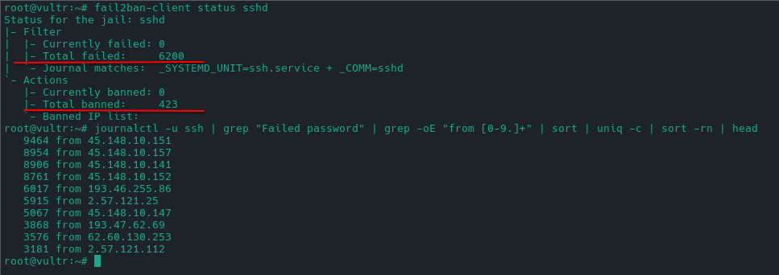

# Security and Risk Analysis

This is the most important part of the project, because here it faced real threats rather than hypothetical ones.

## The real threat landscape: bot attacks

As soon as the server got a public address, automated attacks against it began. The logs show thousands of attempts to guess the SSH password from hundreds of different IPs around the world (trying to log in as `root`, `admin`, `devops`, and so on). This is not a targeted attack — it is the background noise of the internet: bots continuously scan every server in sequence.

## Protecting SSH: from fail2ban to key-only login

The first measure was fail2ban — a tool that bans an IP after several failed login attempts. It works and clearly shows how many attacks are repelled every day.

But fail2ban has a weak spot: a slow distributed brute force (a few attempts each from thousands of different IPs) slips under the per-address limit. So as the primary defence I moved away from it to a more modern standard: SSH login with trusted keys only, with password authentication fully disabled (`PasswordAuthentication no`). A password can be brute-forced; a key practically cannot. This is standard SSH security practice today.

fail2ban was kept in the system deliberately — as a demonstration of how brute-force bots operate and what the real threat picture looks like. Its statistics are illustrative learning material, not the actual line of defence (the line of defence is the disabled password).

## Real incidents and lessons

Several mistakes were made along the way, and each gave a concrete lesson.

**A password was sent unencrypted.** Early on, I logged into a web panel over plain HTTP by IP address — so the password travelled the network in clear text. Lesson: admin panels must never be reachable over an unencrypted connection. Action taken: all panels are accessed only through the VPN or an encrypted tunnel, and public panel ports are closed.

**Forgotten master password.** Because the master password is entered rarely, I forgot it, and recovering access to the old vault was impossible — which is exactly the point of zero-knowledge encryption. Lesson: critical passwords must be stored reliably (for example, physically), not left to memory. Action taken: the master password is recorded in a safe place, and two-factor authentication is enabled.

**Docker bypasses the system firewall.** I discovered that when Docker publishes ports it writes its own rules that bypass the standard firewall (ufw) — so a port can be "open" even if ufw is configured to close it. Lesson: you cannot rely on a single firewall layer. Action taken: critical ports are also controlled at the Vultr cloud firewall, and internal services publish no ports to the outside at all.

**No backups.** For a while there were no backups at all — and the biggest threat to the family's passwords is not a breach (the vault is encrypted) but data loss. Action taken: automatic scheduled backups are in place.

## The minimal attack surface principle

The decision that runs through the whole architecture: only what genuinely must be public is exposed to the outside — the password manager (so the apps can reach it from anywhere) and the VPN port. Everything else — photos, the DNS panel, the VPN panel, the home server — is reachable only from the VPN. What is not exposed to the internet cannot be attacked from the internet.
